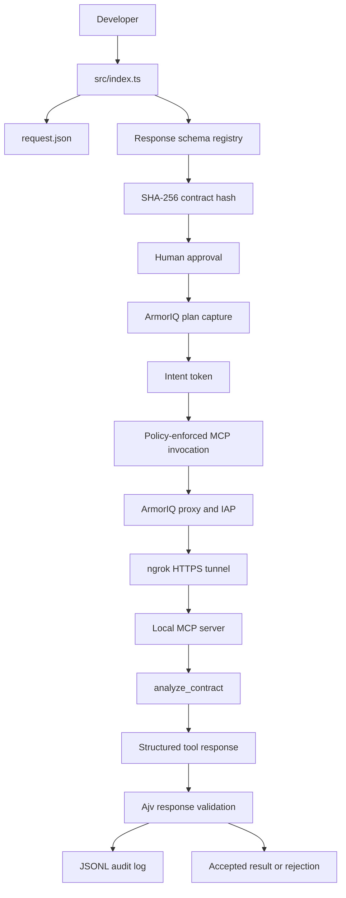
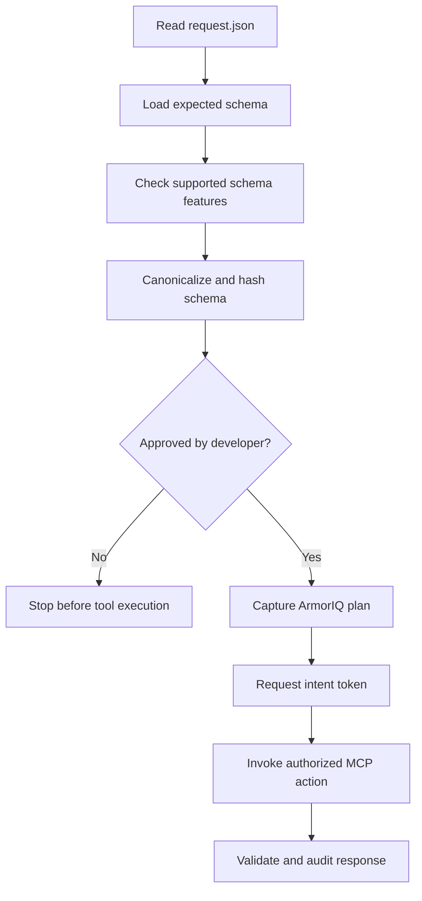
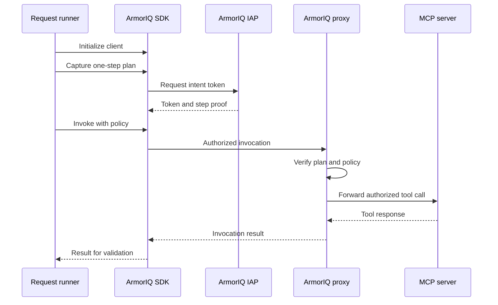
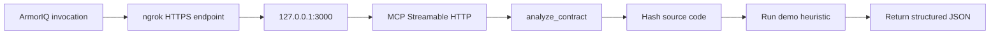
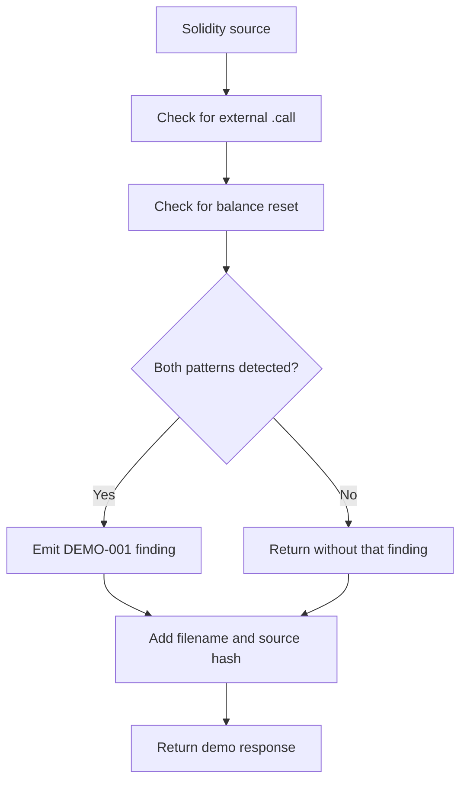
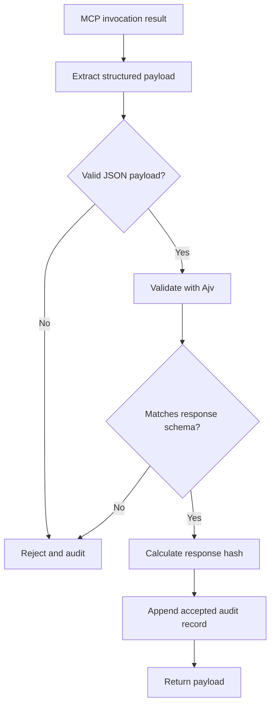
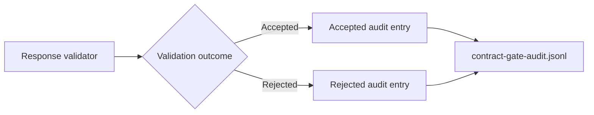

# Specification 
A TypeScript application that gates MCP tool responses using ArmorIQ and
JSON Schema validation, with SHA-256 integrity checks and JSONL audit logs.

`flow-state` demonstrates a security gate around a Solidity-analysis MCP tool.
It combines ArmorIQ's intent authorization, an exposed local MCP endpoint, and
a response contract enforced with Ajv. Before execution, the application
hashes the expected response schema and asks for human approval. It then
captures an execution plan, obtains a short-lived intent token, invokes the
authorized tool, validates the returned payload, and records an audit entry.
The included Solidity analyzer is a deterministic demo heuristic, not a
complete security scanner.

## Architecture

### System overview

The system separates authorization, execution, and response validation.
This matters because a successful tool invocation does not guarantee that
its output has the expected structure or is safe to consume.



### Component responsibilities

#### 1. Request runner

`src/index.ts` is the application's entry point. It loads the request,
constructs the expected response contract, requests approval, and coordinates
the ArmorIQ execution flow.



The approval step makes the expected response contract explicit before
execution. The contract hash can then be associated with the resulting audit
record, making it easier to identify which contract version governed a run.

#### 2. ArmorIQ authorization

The application uses the ArmorIQ TypeScript SDK to capture a plan, request
an intent token, and invoke the action through ArmorIQ's policy-enforcement
path.



The plan identifies the permitted MCP action and its parameters. The
short-lived token binds the invocation to the captured plan. Policy enforcement
helps prevent an invocation from silently changing into an unplanned action.

This does not replace input validation, least-privilege policy configuration,
or independent security testing of the tool itself.

#### 3. MCP transport and tool

`mcp/mcp-server.ts` hosts the MCP server over HTTP. The demo exposes the
`analyze_contract` tool through the `/mcp` endpoint.



The tunnel allows ArmorIQ's remote services to reach the local development
server. The MCP server must be running before the request runner invokes it.
The public tunnel URL must also match the MCP URL registered with ArmorIQ.

The server strips ArmorIQ's `_iam_context` metadata before passing the request
to the MCP transport, preventing authorization metadata from being treated
as an ordinary MCP JSON-RPC parameter.

#### 4. Solidity-analysis heuristic

The current analyzer is deliberately small. It looks for an external `.call`
and a subsequent assignment that resets `balances[msg.sender]` to zero.



This is useful for testing the complete execution and validation pipeline.
It is not a substitute for control-flow analysis, compiler-aware analysis,
fuzzing, symbolic execution, or a production-grade security scanner.
The demo may miss vulnerabilities and may produce false positives.

#### 5. Response contract and validation

`src/response_gaurd.ts` contains the response schema registry and validation
logic. The spelling `gaurd` is intentional here because it matches the
existing source filename.

The schema requires a response with `status`, `filename`, `source_sha256`,
`summary`, and `findings`. Each finding must include an identifier, severity,
title, file, positive line number, and evidence. Unknown properties are
rejected by the current schema.



A successful MCP invocation is not sufficient for acceptance. The payload must
also satisfy the application's response contract. The application returns the
payload only after validation and successful audit logging.

#### 6. Audit trail

`contract-gate-audit.jsonl` is an append-only JSON Lines file. Each line is an
independent JSON object describing an accepted or rejected response.



Records include a timestamp, MCP identifier, action, plan hash, contract hash,
and response hash. Rejection records may also include validation errors.

These hashes help correlate executions and identify changes. They do not,
by themselves, provide tamper-proof storage or prove the underlying finding
is correct. Protect the log and consider signed or remote immutable storage
for production use.

### Repository layout

```text
flow-state/
├── src/
│   ├── index.ts
│   ├── mcp-server.ts
│   └── response_gaurd.ts
├── armoriq.yaml
├── request.json
├── contract-gate-audit.jsonl
├── package.json
├── package-lock.json
└── .env
```

Some generated files, such as `.env` and the audit log, may be local-only
and should not be committed if they contain secrets or sensitive data.

## Getting Started

### Installation

#### Pre-Requisites

Install the following software before setting up the project.

| Software | Requirement | Purpose |
|---|---|---|
| Git | Current stable version | Clone the repository |
| Node.js | 18 or newer | Run the TypeScript application |
| npm | 8 or newer | Install JavaScript dependencies |
| Python | 3.10 or newer | Install the ArmorIQ CLI |
| pipx or pip | Current supported version | Install the ArmorIQ CLI |
| ngrok | Current stable version | Expose the local MCP endpoint |
| ArmorIQ account | Verified account with an organization | Obtain credentials and register the MCP |
| Internet access | HTTPS outbound access | Reach ArmorIQ services and install dependencies |

The project also needs an ArmorIQ API key, a user identity, an agent identity,
and an email value as expected by the application's environment configuration.

##### macOS

On a fresh macOS installation, first install Apple's command-line tools:

```bash
xcode-select --install
```

Install Homebrew by following its official instructions:

https://brew.sh/

Then install Git, Node.js, Python, pipx, and ngrok:

```bash
brew install git node python pipx
brew install ngrok/ngrok/ngrok
```

Verify the installations:

```bash
git --version
node --version
npm --version
python3 --version
pipx --version
ngrok version
```

If Homebrew or ngrok's installation instructions have changed, follow the
current official documentation linked below.

##### Linux

On Ubuntu or Debian, install the basic development tools:

```bash
sudo apt update
sudo apt install -y git curl ca-certificates python3 python3-pip \
  python3-venv pipx
```

Install Node.js 18 or newer and npm using a maintained distribution method
appropriate for your Linux distribution. Verify that the installed versions
meet the requirements:

```bash
git --version
python3 --version
pipx --version
node --version
npm --version
```

Install ngrok by following its official Linux installation instructions:

https://ngrok.com/download

Ensure `node`, `npm`, `python3`, `pipx`, and `ngrok` are available on your
shell's `PATH`. On distributions where pipx is installed outside the default
path, run:

```bash
pipx ensurepath
```

Restart the terminal if your shell configuration requires it.

##### Windows

Install the following using the official installers:

- Git: https://git-scm.com/download/win
- Node.js LTS: https://nodejs.org/
- Python: https://www.python.org/downloads/windows/
- ngrok: https://ngrok.com/download

During installation, enable the options that add Git, Node.js, and Python to
`PATH` when offered. Install Python 3.10 or newer and ensure `pip` is enabled.

Open a new PowerShell terminal and verify:

```powershell
git --version
node --version
npm --version
py --version
py -m pip --version
```

Install pipx for the current user:

```powershell
py -m pip install --user pipx
py -m pipx ensurepath
```

Close and reopen PowerShell, then verify:

```powershell
pipx --version
ngrok version
```

If a command is not found, check the installer and `PATH` before continuing.

#### Install the ArmorIQ CLI

The project uses the TypeScript SDK at runtime, but the ArmorIQ CLI is useful
for account authentication and configuration registration. Install it using
the Python package:

```bash
pipx install armoriq-sdk
```

If pipx is unavailable, install the package in a dedicated Python environment
or follow ArmorIQ's current installation documentation:

https://docs.armoriq.ai/sdk/installation

Verify the CLI:

```bash
armoriq --help
```

Authenticate with ArmorIQ:

```bash
armoriq login
armoriq whoami
armoriq orgs
```

Complete the browser authentication flow and confirm that your account belongs
to the organization you intend to use. Do not share your API key or commit it
to source control.

Official ArmorIQ documentation:

- Installation: https://docs.armoriq.ai/sdk/installation
- CLI: https://docs.armoriq.ai/cli
- Configuration: https://docs.armoriq.ai/platform/sdk-cli/armoriq-yaml

#### Clone the repository

Replace `<YOUR_REPOSITORY_URL>` with the actual Git repository URL.

```bash
git clone <YOUR_REPOSITORY_URL> flow-state
cd flow-state
npm install
```

Confirm that the expected files exist:

```bash
ls
ls src
```

On Windows PowerShell, use `Get-ChildItem` if preferred:

```powershell
Get-ChildItem
Get-ChildItem src
```

#### Configure ArmorIQ

Open `armoriq.yaml` and confirm the MCP identifier, tool name, endpoint,
identity, and policy. The registered MCP identifier must match the identifier
used by `src/index.ts` and the response schema registry.

The demo configuration uses these values:

```yaml
identity:
  api_key: $ARMORIQ_API_KEY
  user_id: security-service
  agent_id: security-assessment-bot

proxy:
  url: https://proxy.armoriq.ai
  timeout: 30
  max_retries: 3

mcp_servers:
  - id: security-assessment-mcp-2
    url: https://YOUR-NGROK-HOST/mcp
    auth:
      type: none
    description: Local demo for testing the response contract

policy:
  allow:
    - security-assessment-mcp-2.analyze_contract
  deny: []
```

Keep any other required fields from the repository's existing configuration.
The snippet above illustrates the important values; it is not intended to
replace the complete working configuration blindly.

The `user_id` and `agent_id` values must match the identity values used by the
application. Keep the policy limited to the tool needed for this demo.

#### Configure environment variables

The request runner expects these environment variables:

- `ARMORIQ_API_KEY`: your ArmorIQ API key.
- `ARMORIQ_USER_ID`: the service user identity.
- `ARMORIQ_AGENT_ID`: the agent identity.
- `USER_EMAIL`: the email identity used for invocation context.

Use the values appropriate for your ArmorIQ account and project. Do not paste
your API key into a README, source file, issue, or public terminal recording.

For macOS and Linux, export the variables in the terminal that will run the
application:

```bash
export ARMORIQ_API_KEY="YOUR_ARMORIQ_API_KEY"
export ARMORIQ_USER_ID="security-service"
export ARMORIQ_AGENT_ID="security-assessment-bot"
export USER_EMAIL="YOUR_EMAIL"
```

For Windows PowerShell:

```powershell
$env:ARMORIQ_API_KEY = "YOUR_ARMORIQ_API_KEY"
$env:ARMORIQ_USER_ID = "security-service"
$env:ARMORIQ_AGENT_ID = "security-assessment-bot"
$env:USER_EMAIL = "YOUR_EMAIL"
```

These environment variables apply to the current terminal session. Set them
again in each terminal that needs them, or use your own local secret manager.

If the project uses a local `.env` file, create it from the expected variable
names and ensure the application loads it. Never commit a real `.env` file.

#### Register the MCP endpoint

Start the local MCP server before testing the public tunnel. Open a dedicated
terminal in the project directory:

```bash
npx tsx mcp/mcp-server.ts
```

Keep this process running.

In a second terminal, start ngrok:

```bash
ngrok http 3000
```

Copy the HTTPS forwarding URL from ngrok. Append `/mcp` to form the MCP
endpoint, then update the `url` field in `armoriq.yaml`.

For example, if ngrok prints:

```text
https://example.ngrok-free.app
```

the MCP URL is:

```text
https://example.ngrok-free.app/mcp
```

The example host is illustrative. Use the URL generated by your own ngrok
session. A new tunnel URL may require updating and re-registering the config.

Validate and register the configuration:

```bash
armoriq validate
armoriq register
armoriq status
```

If your installed CLI does not recognize a command or option, consult
`armoriq --help` and the current ArmorIQ CLI documentation. CLI capabilities
can differ between package distributions.

### Usage

#### Start the MCP server

Open the first terminal:

```bash
cd flow-state
npx tsx mcp/mcp-server.ts
```

The server must remain running on port `3000`.

#### Start ngrok

Open the second terminal:

```bash
ngrok http 3000
```

Confirm that the HTTPS forwarding URL matches the URL registered in
`armoriq.yaml`. If the URL changes, update the configuration and register it
again before running the request.

#### Run the request

Open a third terminal. Set the required environment variables in this
terminal, then run:

```bash
cd flow-state
npm start -- request.json
```

The program will:

1. Load the request and response schema.
2. Compute and display the response contract hash.
3. Ask for approval before executing the action.
4. Capture an ArmorIQ plan and request an intent token.
5. Invoke `analyze_contract` through ArmorIQ.
6. Validate the returned payload against the JSON Schema.
7. Append an audit entry and print the accepted result.

Enter `y` when prompted to approve the contract. Any other response should
leave the action unapproved.

#### Run without the interactive approval prompt

The application supports a `--yes` flag in the request runner:

```bash
npm start -- request.json --yes
```

Use this only when you intentionally want to bypass the interactive approval
step. It does not remove the need for the response contract or its validation.
Confirm the exact argument handling in `src/index.ts` if you modify the CLI.

#### Inspect the audit log

After a successful run, inspect the latest entries:

```bash
tail -n 5 contract-gate-audit.jsonl
```

On Windows PowerShell:

```powershell
Get-Content contract-gate-audit.jsonl -Tail 5
```

Each line is a JSON object. Accepted entries should include `status`,
`mcp`, `action`, `planHash`, `contractHash`, and `responseHash`. Rejected
entries should include relevant validation errors when available.

To search for rejected entries on macOS or Linux:

```bash
grep '"status":"rejected"' contract-gate-audit.jsonl
```

In PowerShell:

```powershell
Select-String '"status":"rejected"' contract-gate-audit.jsonl
```

#### Stop the services

Use `Ctrl+C` in the terminal running each foreground process:

- Request runner
- ngrok
- MCP server

The request runner exits after completing the invocation. The MCP server and
ngrok must be stopped separately.

#### Troubleshooting

**ngrok returns `502 Bad Gateway` or `ERR_NGROK_8012`.**

The tunnel cannot reach the local server. Confirm that `npx tsx
mcp/mcp-server.ts` is running and listening on port `3000`.

On macOS or Linux:

```bash
lsof -nP -iTCP:3000 -sTCP:LISTEN
curl -i http://127.0.0.1:3000/mcp
```

A protocol-level response to a basic GET may not be a successful MCP call.
The important point is that the TCP connection reaches the server.

**ArmorIQ reports an authentication error.**

Check the API key, identity variables, organization, and login status:

```bash
armoriq whoami
armoriq status
```

Reauthenticate if needed:

```bash
armoriq login
```

**The MCP tool is not found or policy denies the invocation.**

Verify that the MCP ID and action match in all of these locations:

- `armoriq.yaml`
- The request plan in `request.json`
- The schema registry in `src/response_gaurd.ts`

Then validate and register the configuration again.

**The response is rejected.**

Inspect the validation errors and the latest audit entry. Confirm that the
tool response includes every required property, uses an allowed severity,
has a positive integer line number, and contains no unexpected fields.

**The audit log is not updated.**

The validator writes audit entries only when its corresponding execution path
reaches the audit logic. A network failure before a tool response reaches the
validator may therefore produce no response-validation entry.

#### Security considerations

- Never commit API keys or other credentials.
- Keep the ArmorIQ policy restricted to the minimum required tools.
- Treat the demo analyzer's output as an unverified candidate finding.
- Do not expose the local MCP server directly to the public internet.
- Use a controlled tunnel and keep it running only while testing.
- Treat the JSONL audit file as sensitive operational data.
- For production use, add stronger audit-log integrity protections,
  comprehensive schema tests, and a real security-analysis engine.

